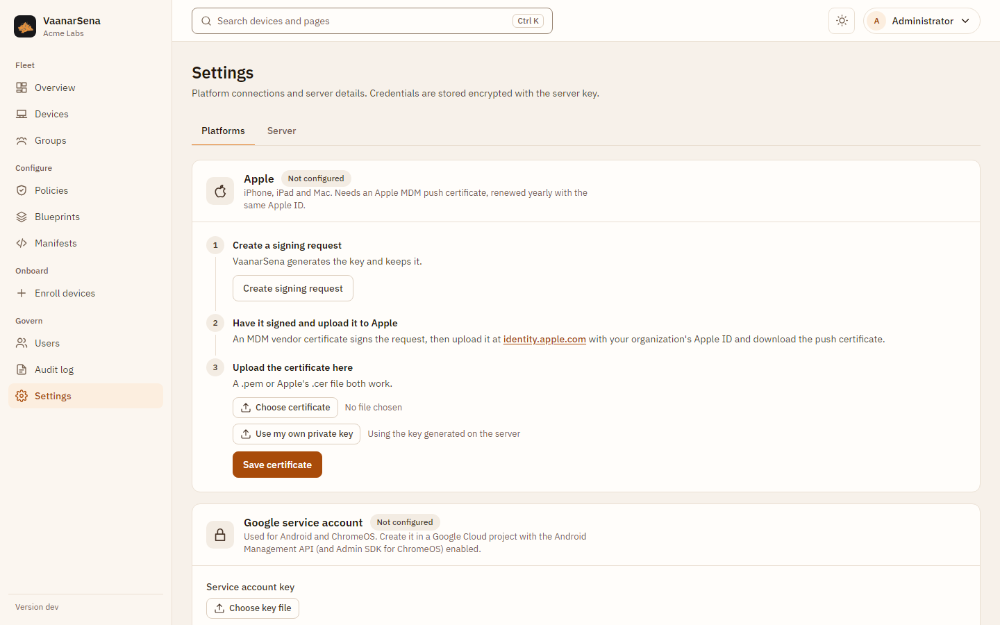

# Platform setup

Windows and Linux work out of the box. Apple, Android and ChromeOS need
credentials from Apple or Google, which you connect in the console under
**Settings > Platforms**. Apple and Android also need Apple's or Google's
approval of your **organization**, which individuals and personal use do not
get; read the warning in each section before you start. Credentials are stored encrypted with the server key
and take effect immediately, with no restart.



Every platform can also be configured with environment variables instead (see
[Configuration](configuration.md)). A platform configured that way shows
"Set by environment variables" in the console and cannot be changed there.

## Apple (iOS, iPadOS, macOS)

Apple devices are woken through Apple's push service (APNs), which needs an
**MDM push certificate** for your organization.

!!! warning "Before you start: Apple only issues this to organizations"
    Apple's push portal accepts a request only when it is signed with an
    **MDM vendor certificate** issued by Apple. Apple gives that certificate
    only to organizations (Apple Developer Program enrolled as an
    organization, with the "MDM CSR" capability requested from Apple), and
    excludes individuals and personal use, including test setups. Community
    signing services apply the same rule (see
    [Community signing services](#community-signing-services)).

    - Uploading the unsigned `vaanarsena-push.csr` directly fails with
      "Invalid Certificate Signing Request". The same message appears when
      the signed request is in the wrong format or signed with the wrong key.
    - Your domain's TLS certificate (for example Let's Encrypt) cannot sign
      it: Apple checks the signature against its own vendor certificate
      chain.
    - Hosted MDM products sign requests with their own vendor certificate.
      A self-hosted VaanarSena has no vendor of its own, so the organization
      running it needs one.

    Without a push certificate, Apple devices cannot be managed. Windows,
    Linux and ChromeOS are not affected.

1. **Create a signing request.** In Settings > Platforms > Apple, choose
   **Create signing request** and download `vaanarsena-push.csr`. VaanarSena
   generates the private key and keeps it; it never leaves the server. The
   server keeps only the key of the latest request: do not create another
   one until you have saved the certificate for this one.
2. **Have it signed and upload it to Apple.** Sign the request with your
   organization's MDM vendor certificate (see
   [Signing the request](#signing-the-request)). Upload the signed
   request at [identity.apple.com](https://identity.apple.com/pushcert) with your
   organization's Apple ID (not a personal one: renewals need the same Apple
   ID) and download the push certificate.
3. **Upload the certificate.** Choose the `.pem` or Apple's `.cer` file and
   **Save certificate**. Apple enrollment is on as soon as it saves.

Already have a certificate and key from another tool? Use **Use my own private
key** in step 3 instead of generating a request.

The certificate lasts one year. **Renew it with the same Apple ID**: a new
certificate with a different push topic orphans every enrolled device. The
server logs a warning 30 days before it expires.

### Signing the request

Apple describes the format in
[Setting up push notifications for your device management customers](https://developer.apple.com/documentation/devicemanagement/setting-up-push-notifications-for-your-device-management-customers).
You need:

- `mdm.cer` and `vendor.key`: your "MDM Vendor CSR Signing Certificate"
  from the Apple Developer portal and the key you created it with.
- `AppleWWDRCAG3.cer` from
  [apple.com/certificateauthority](https://www.apple.com/certificateauthority/)
  and `AppleIncRootCertificate.cer` from
  [apple.com/appleca](https://www.apple.com/appleca/).

Check that the key belongs to the certificate (both lines must match):

```bash
openssl x509 -inform der -in mdm.cer -noout -modulus | openssl md5
openssl rsa -in vendor.key -noout -modulus | openssl md5
```

Then build the signed request. It is a property list with the request (DER,
base64), the certificate chain (PEM: vendor certificate, WWDR intermediate,
Apple root, in that order) and a SHA-256 RSA signature of the DER request,
itself base64-encoded:

```bash
openssl req -in vaanarsena-push.csr -outform der -out push.der
openssl dgst -sha256 -sign vendor.key -out push.sig push.der
for c in mdm.cer AppleWWDRCAG3.cer AppleIncRootCertificate.cer; do
  openssl x509 -inform der -in "$c"
done > chain.pem
openssl verify -CAfile chain.pem chain.pem   # the chain must reach Apple's root

cat > push.plist <<EOF
<?xml version="1.0" encoding="UTF-8"?>
<!DOCTYPE plist PUBLIC "-//Apple//DTD PLIST 1.0//EN" "http://www.apple.com/DTDs/PropertyList-1.0.dtd">
<plist version="1.0">
<dict>
  <key>PushCertRequestCSR</key>
  <string>$(openssl base64 -A -in push.der)</string>
  <key>PushCertCertificateChain</key>
  <string>$(cat chain.pem)</string>
  <key>PushCertSignature</key>
  <string>$(openssl base64 -A -in push.sig)</string>
</dict>
</plist>
EOF
openssl base64 -A -in push.plist > vaanarsena-push-signed.b64
```

Upload `vaanarsena-push-signed.b64` to Apple. Keep `vendor.key` private and
reuse it every year to sign the renewal request.

### Community signing services

Services such as mdmcert.download sign push requests for organizations that
have no vendor certificate of their own. They also accept only legally
recognized organizations, not individuals. Their client protocol (the MDM
server submits the request with an encryption certificate, and the signed
request comes back encrypted by email) is not built into VaanarSena, because
it is not publicly documented. Use one only if the service gives you a signed
request you can upload to Apple yourself.

There is no route for individuals or test setups without an organization:
APNs is the only way to wake an Apple device, so without a push certificate
an enrolled device never checks in. To test without Apple, use Windows,
Linux, ChromeOS or Android devices.

**Company-owned devices:** create an Apple, company-owned enrollment, open
the link in Safari on the device and install the profile from Settings.

**Personal devices (User Enrollment):** create an Apple, personal enrollment
with the user's **Managed Apple ID** (from Apple Business Manager) as the
user. iOS creates a separate managed volume; the organization cannot see
personal data, read hardware identifiers or erase the device, and the server
refuses those commands anyway.

Not yet supported: Automated Device Enrollment (ABM/DEP), Apps and Books (VPP)
licensing, Declarative Device Management. `install_app` works with an
enterprise app manifest URL.

## Windows 10 and 11

Built in; nothing to set up. Windows uses the on-premises enrollment flow:
the user's email plus the enrollment token as the password.

1. In **Enroll devices**, choose Windows, enter the user's email and create the
   enrollment.
2. On the PC: **Settings > Accounts > Access work or school > Enroll only in
   device management**, or open the `ms-device-enrollment:` link from the
   console.
3. Enter the email and the server address shown, then the token when asked
   for a password.

Home editions of Windows have no MDM client; use Pro, Enterprise or Education.

For enrollment by email address alone, publish
`enterpriseenrollment.<your-email-domain>` as a CNAME to the server.

Windows checks in every 15 minutes and at sign-in. Push wake-ups need
Microsoft's WNS and are not used.

The management endpoint authenticates the PC by TLS client certificate.
Behind a proxy, the proxy must request the client certificate and pass it on;
see [Hosting](hosting.md).

Personal PCs receive only sign-in (`DeviceLock`) policies. BitLocker, camera,
USB and update policies are company-owned only.

Compliance is evaluated at each inventory refresh against what the device's
policy requires and what Windows reports: a PC whose policy requires
encryption is non-compliant until BitLocker reports it encrypted. A PC with no
encryption requirement is not marked non-compliant for being unencrypted.
Windows compliance covers encryption only: passcode, firewall and the other
settings are enforced through the Policy CSP but not evaluated, so keep that
in mind before using Windows compliance for conditional access.

Installing an MSI needs `appId` (the product code), `url`, `hash` (SHA-256 of
the file) and `version`; removing one needs `appId`. Commands missing them are
refused when sent.

## Android

Uses Google's **Android Management API**. You need a Google Cloud project with
a service account, then an Android Enterprise bound to it.

!!! warning "Before you start: Google must approve your project"
    Google restricts the Android Management API to commercial EMM providers
    with a business justification (see Google's
    [permissible usage](https://developers.google.com/android/management/permissible-usage)
    page). Solutions used only in-house, and personal use, are not permitted.

    - **New projects can enroll no devices** until Google approves them.
      Every enrollment fails on the device, whatever the mode: a work
      profile shows "your organization has reached its usage limits", and a
      fully managed device may show "your IT admin doesn't allow this policy".
      VaanarSena and the device are not at fault; the API key and the
      enterprise connection still work, so nothing looks wrong until the
      first enrollment.
    - **Request quota** with the form linked from the permissible usage page
      (an initial quota of up to 500 devices needs a full business
      justification; Google grants quota to at most two projects per
      developer). Approval takes weeks. Do this before planning a rollout.
    - **Use organization accounts throughout**, not personal Gmail accounts:
      own the Cloud project from your organization's Google account, and sign
      up for the Android Enterprise with a work account (a Google Workspace
      admin, or a work email verified with Google; Google's sign-up may
      refuse a personal address). The account that signs up becomes the
      enterprise's admin, so it should belong to the organization, not to
      whoever set it up.
    - Hosted MDM products enroll through their own approved project. A
      self-hosted VaanarSena uses yours, so the approval has to be yours.

### 1. Create the service account

Sign in to `gcloud` with your organization's account (the project owner),
then create the project, the service account and its key. Replace the
placeholders; project IDs are global, so pick a unique one.

```bash
gcloud auth login admin@example.com
PROJECT=example-mdm                       # your project ID
SA=vaanarsena-amapi@$PROJECT.iam.gserviceaccount.com

gcloud projects create $PROJECT                    # skip if it exists
gcloud services enable androidmanagement.googleapis.com --project=$PROJECT
gcloud iam service-accounts create vaanarsena-amapi \
  --display-name="VaanarSena Android management" --project=$PROJECT
gcloud projects add-iam-policy-binding $PROJECT --condition=None \
  --member="serviceAccount:$SA" --role=roles/androidmanagement.user
gcloud iam service-accounts keys create vaanarsena-amapi.json \
  --iam-account=$SA --project=$PROJECT
```

In VaanarSena, **Settings > Platforms > Google service account**: choose
`vaanarsena-amapi.json` (the project ID is read from it) and **Save key**.
Then delete the local file: the key is stored encrypted on the server, and
anyone holding the file can manage your enterprise.

If key creation fails with `constraints/iam.disableServiceAccountKeyCreation`,
your Google Cloud organization blocks service account keys (the default for
organizations created since 2024). An organization policy administrator can
allow it for this project only:

```bash
gcloud resource-manager org-policies disable-enforce \
  iam.disableServiceAccountKeyCreation --project=$PROJECT
```

The console works too: **APIs & Services > Library** (Android Management
API), **IAM & Admin > Service accounts** (create, role *Android Management
User*), then **Keys > Add key > JSON**.

**Moving to another project** (for example from a personal account to the
organization's): choose **Replace key** with the new key, **Remove** on the
Android Enterprise card, connect a new enterprise (step 2) and re-enroll
devices; an enterprise belongs to the project it was created with. Then delete the old
key: `gcloud iam service-accounts keys list --iam-account=<old SA>` and
`gcloud iam service-accounts keys delete <key id> --iam-account=<old SA>`.

### 2. Connect the Android Enterprise

In **Settings > Platforms > Android**, choose **Connect Android Enterprise**.

You are sent to Google's sign-up, where you name the enterprise and accept the
terms with a Google account. Google then sends you back to VaanarSena, which
creates the enterprise and turns Android management on. The page shows
"Android Enterprise connected".

That return trip is authenticated by a single-use link that expires after an
hour, so the sign-up must be finished in one go. If it fails or times out,
choose Connect again.

Already have an enterprise (for example from an earlier installation)? Enter
its name, `enterprises/LC0...`, under **Already have an enterprise?** instead.

### 3. Enroll devices

**Company-owned (fully managed):** create an Android, company-owned
enrollment. On a factory-reset device, tap the welcome screen six times and
scan the QR code from the console.

**Personal (work profile):** create an Android, personal enrollment and open
the enrollment link on the phone. Android isolates the work profile;
**Retire** deletes it and leaves personal data alone.

Devices sync every 5 minutes. Apps are managed through the policy **Apps**
section (platform Android), and raw Android Management API fields can be added
under **Custom payloads**.

Commands are sent to Google as soon as they are queued. If that is missed (the
Android connection was down or reconfigured, or the server restarted), the
next sync sends whatever is still queued. A command shows as done once Google
accepts it; the device carries it out when it next connects.

## ChromeOS

ChromeOS devices are enrolled into your Google Workspace or Chrome Enterprise
domain on the device itself. VaanarSena imports them and sends commands.

1. Add the Google service account (see Android, step 1) and enable the
   **Admin SDK API** in the same project.
2. In the [Google Admin console](https://admin.google.com), **Security > API
   controls > Domain-wide delegation**, add the service account's client ID
   with the scope `https://www.googleapis.com/auth/admin.directory.device.chromeos`.
3. In **Settings > Platforms > ChromeOS**, enter a Workspace admin the service
   account may act as, and **Connect ChromeOS**.

Chromebooks sync every 15 minutes. Supported commands: refresh, restart, lock
(disable), erase (remote powerwash) and retire (deprovision). Device policy
stays in the Google Admin console.

A Chromebook counts as enrolled when it is first imported active, or when it
finishes provisioning. It then joins its smart groups and runs the onboarding
steps of blueprints that target them, like devices of other platforms (steps
ChromeOS does not support are skipped and audited). Commands still queued at a
sync are sent then.

## Linux

Built in. The agent supports systemd-based distributions with apt, dnf, zypper
or pacman, on amd64 and arm64. Download it from the
[releases page](https://github.com/dmdhrumilmistry/VaanarSena/releases/latest).

```bash
sudo install -m 0755 vaanarsena-agent-linux-amd64 /usr/local/bin/vaanarsena-agent
sudo vaanarsena-agent enroll --server https://mdm.example.com --token <TOKEN>
# With a private TLS CA:  --server-ca /path/to/ca.pem
sudo curl -fsSLo /etc/systemd/system/vaanarsena-agent.service \
  https://github.com/dmdhrumilmistry/VaanarSena/releases/latest/download/vaanarsena-agent.service
sudo systemctl enable --now vaanarsena-agent
```

The agent checks in every 60 seconds over mutual TLS. Company-owned machines
support lock, restart, shutdown, OS update, package install and remove (by
package name in `appId`), and running scripts (admins only; the full script is
written to the audit log).

What the agent enforces from the policy, on company-owned machines:

| Policy | On the machine |
|---|---|
| `restrictions.usbStorage: false` | `/etc/modprobe.d/vaanarsena-usb.conf` stops the `usb-storage` module loading. Removed when the policy stops blocking USB storage. |
| `passcode.required`, `passcode.maxInactivityMinutes` | GNOME screen lock through the system dconf database: `/etc/dconf/db/local.d/00-vaanarsena` sets the idle delay and turns the lock on, `locks/vaanarsena` stops users changing them, then `dconf update`. `/etc/dconf/profile/user` is created if missing and never rewritten. Machines without dconf (servers, other desktops) are not enforced. |
| `encryption.required` | Reported only: the machine is non-compliant without a LUKS volume. |

The agent writes only files it owns and removes them when the policy no longer
asks for them, when the machine becomes personal, and on retire. **Re-apply
policy** restores anything changed on the machine since. Compliance reports
each control the agent could not confirm, for example "USB storage must be
blocked" or "screen lock settings are not applied".

Personal machines run in **inventory-only** mode: the agent sends basic facts
(no serial numbers or hardware identifiers), enforces nothing, and refuses
every command except refresh, re-apply policy and retire, even if the server
were to send one. Compliance on personal machines covers only what is
observed, not enforced (disk encryption), so they are not reported
non-compliant for controls the agent deliberately leaves alone.
